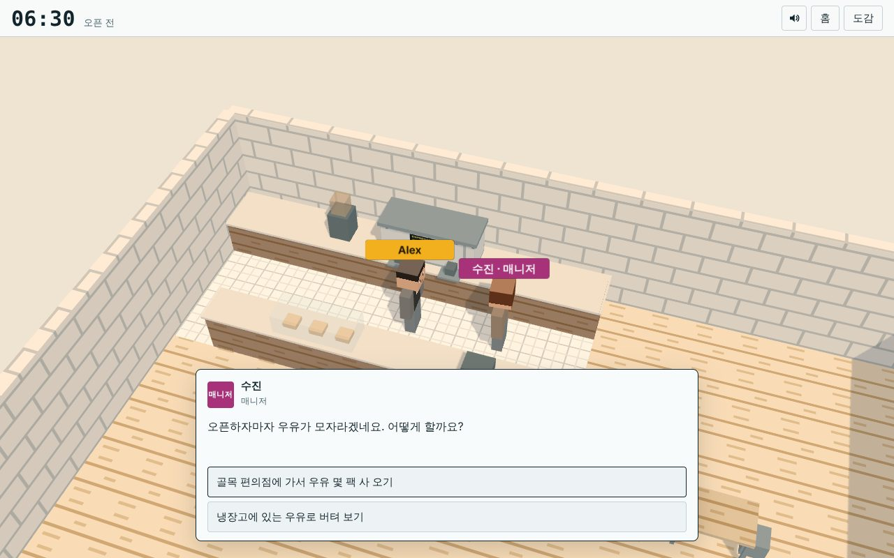
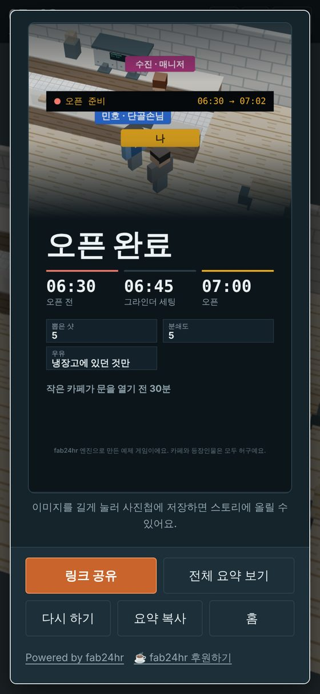

# fab24hr 엔진

브라우저에서 돌아가는 3D 스토리 게임을 만드는 작은 프레임워크예요. 대부분의 사람이 한 번도 본 적 없는 직업으로 하루 근무를 해 보는, 그런 게임에 잘 맞아요. [fab24hr](https://fab24hr.com) 게임을 움직이는 엔진을 떼어 내서, 누구나 자기 게임을 만들 수 있게 했어요.

플레이어가 얻는 것: 걸어 다닐 수 있는 블록 스타일의 3D 공간(휴대폰과 컴퓨터 모두, 설치 없이), 말을 걸어오는 사람들, ‘길 안내’ 버튼이 달린 ‘다음 할 일’ 한 줄, 갑자기 걸려 오는 전화, 누르면 쉬운 설명이 나오는 전문 용어, 작은 미니게임, 도감, 저장하고 이어서 하기, 그리고 마지막의 요약 카드: 저장해서 올릴 수 있는 9:16 이미지와 공유 링크.

만드는 사람이 얻는 것: import를 직접 관리할 필요 없는 평범한 JavaScript 파일, 실수를 잡아 주는 빌드, 자동 플레이 테스트.

비상업적 용도라면 무료예요. 시간을 아꼈다면 [제작자에게 커피 한 잔](https://buymeacoffee.com/mclty) 사 줄 수 있어요.

<p align="center"> </p>

> **현재 상태: 초기(0.3).** 아래의 예제 게임은 처음부터 끝까지 플레이할 수 있어요. 이름은 아직 바뀔 수 있어요. 버전마다 무엇이 들어 있는지, 엔진에 아직 없는 것은 무엇인지: [`CHANGELOG.md`](CHANGELOG.md)(영어).

## 빠르게 시작하기

[Node.js](https://nodejs.org) 18 이상이 필요해요.

```sh
npm install
npm run build      # → public/index.html (브라우저로 열거나, public/ 폴더를 아무 정적 호스팅에 올리면 돼요)
npm run dev        # 빌드하고 http://localhost:8080 에서 열어요. 저장하면 다시 빌드해요
npm test           # 헤드리스 브라우저로 게임 전체를 두 번 플레이해요(컴퓨터 + 휴대폰)
npm run ko         # 한국어로 바꾸기 (npm run en 으로 영어로 돌아가요)
```

`npm test`에는 Chromium 계열 브라우저가 필요해요. 브라우저를 찾을 수 없다고 나오면 `npx playwright-core install chromium`을 한 번 실행하고 다시 해 보세요.

**한국어로 개발하려면:** `npm run ko`를 실행하면 화면 언어와 예제 게임이 한 번에 한국어로 바뀌어요(예제는 ‘오픈 준비’가 돼요). `npm run en`으로 영어로 돌아가요. AI 코딩 도구에 한국어로 말하면 도구가 알아서 먼저 한국어로 바꾸고, 답변, 게임 속 글, 주석도 한국어로 써요. 중국어(번체)는 `npm run zh`예요.

예제 게임 **Opening Shift**(한국어판은 ‘오픈 준비’)가 들어 있어요. 작은 카페가 문을 열기 전 30분 이야기로, 5분 정도 걸리고 엔진의 모든 부분을 써요. 파일은 `game/`에 있고, 영어, 중국어(번체), 한국어 원본은 `samples/`에 있어요.

## AI 코딩 도구로 나만의 게임 만들기

이 저장소는 AI 코딩 도구로 작업하기 좋게 준비되어 있어요. 도구로 폴더를 열고 이렇게 말해 보세요.

> 기차역 야간 근무 게임으로 바꿔 줘. 길이는 5분 정도로.

도구는 먼저 [`AGENTS.md`](AGENTS.md)를 읽어요(게임 파일이 어떻게 맞물리는지, 빌드가 막는 규칙, 테스트 방법). 다 바꾸고 나면 `npm test`를 실행하고, 직접 한 번 플레이해 보세요.

## 직접 손으로 나만의 게임 만들기

게임에 관한 모든 것은 `game/`에 있어요.

| 파일 | 들어 있는 것 |
| --- | --- |
| `game.json` | 제목, 언어, 저장 키, 그리고 내 파일 목록(불러오는 순서대로) |
| `data.js` | 홈 화면 글, 사람(`STORY.cast`, `WORLD.cast`), 장소, 용어 |
| `cafe.js` | 3D 공간: 바닥, 벽, 가구, 사람이 서고 걸을 수 있는 곳 |
| `story.js` | 하루의 순간들(`STORY.segs`), 한 번에 하나씩 할 일(`STORY.beats`), 미니게임, 요약 카드 |
| `game.css` | 선택: 색 바꾸기(라이트·다크 모드) |

각 부분은 `AGENTS.md`에 자세히 나와 있어요.

## 엔진에 들어 있는 것

| 파일 | 하는 일 |
| --- | --- |
| `engine/world.js` | 3D 세계(three.js r128): 이름표를 단 블록 사람들, 걷기와 길 찾기, 카메라, ‘!’와 ‘?’ 표시, 자동 화질 조절 |
| `engine/story.js` | 순간과 할 일, ‘다음 할 일’ 한 줄, 시각 카드, 저장과 이어서 하기, 사람에게 걸어가서 말 걸기 |
| `engine/dialog.js` | 대화창: 한 글자씩 나오는 효과, 선택지, 누를 수 있는 전문 용어 |
| `engine/move.js` | 화면 위 방향 버튼, 말 걸기 버튼, 화면 가장자리 화살표, 키보드 |
| `engine/ui.js` | 패널, 문서 창, 알림, 전화 |
| `engine/share.js` | 9:16 공유 카드, 카드 / 전체 요약 보기, 복사와 링크 공유 버튼 |
| `engine/home.js`, `end.js`, `codex.js` | 홈 화면, 요약 카드, 도감 |
| `engine/sfx.js` | Web Audio로 합성하는 소리(오디오 파일 없음) |
| `engine/quality.js` | 기기가 부드럽게 돌릴 수 있는 가장 좋은 해상도와 그림자를 골라요 |
| `tools/build.js`, `esm.js`, `i18n.js` | 빌드: 파일을 이어 붙이고, import와 export를 알아서 만들고, 불러오는 순서를 확인하고, esbuild로 묶어요 |

## 후원

엔진은 비상업적 용도라면 무료예요. 시간을 아꼈다면 [제작자에게 커피 한 잔](https://buymeacoffee.com/mclty) 사 줄 수 있어요. 후원금은 fab24hr 게임과 이 엔진을 계속 만드는 데 드는 AI 사용료로 써요.

이 엔진으로 만든 모든 게임은 홈 화면과 마지막 화면에 링크 두 개가 있는 작은 한 줄을 보여 줘요: ‘Powered by fab24hr’ 링크와 ‘☕ fab24hr 후원하기’ 링크예요(두 번째 링크는 게임의 언어로 나와요). 라이선스에 따라 이 줄은 그대로 남겨 둬야 해요. 게임에 맞게 스타일을 바꾸는 건 괜찮아요.

## 라이선스

- 엔진과 도구: [fab24hr engine License](LICENSE). 핵심은 이래요.
  - **비상업적 용도로만 쓸 수 있어요.** 엔진으로 만든 게임을 팔거나, 돈을 받고 플레이하게 하거나, 게임 안에서 무언가를 팔거나, 광고나 협찬 콘텐츠를 넣거나, 고객이나 회사를 위한 유료 작업으로 만들거나, 사업 홍보에 쓰면 안 돼요. 플레이어에게 자발적인 후원을 부탁하는 건 괜찮아요(예: `HOME.support`로 내 후원 링크 넣기). 단, 후원을 하든 안 하든 게임은 똑같아야 해요.
  - **출처 한 줄을 남겨 두세요.** 홈 화면과 마지막 화면 둘 다요. 스타일은 바꿔도 되지만, 지우거나 숨기거나 링크를 다른 곳으로 바꾸면 안 돼요.
  - 상업적으로 쓰거나 다른 조건으로 쓰고 싶다면 mcl@mclty.com으로 메일을 보내 주세요.
- 예제 게임의 글과 그림(`game/`): [CC BY 4.0](https://creativecommons.org/licenses/by/4.0/deed.ko).
- three.js(`vendor/three.min.js`): MIT, [`THIRD_PARTY.md`](THIRD_PARTY.md)를 보세요.
- 빌드는 게임 스크립트 맨 위에도 한 줄을 넣어요: `/*! Made with the fab24hr engine (…) | fab24hr engine License (…) | Copyright … */`. 이 줄도 남겨 두세요.
- 이름 fab24hr, 그리고 fab24hr 게임 자체의 스토리, 캐릭터, 콘텐츠는 위 라이선스에 포함되지 않아요. 게임 이름을 fab24hr로 짓거나, 그 제작자가 만든 것처럼 소개하지 말아 주세요.

지원은 보장하지 않아요. 이슈와 풀 리퀘스트는 환영하지만 답이 늦을 수 있어요. 연락처: mcl@mclty.com.

사람이 AI와 함께 썼어요.

[English](README.md) · [中文說明](README.zh-Hant.md)
